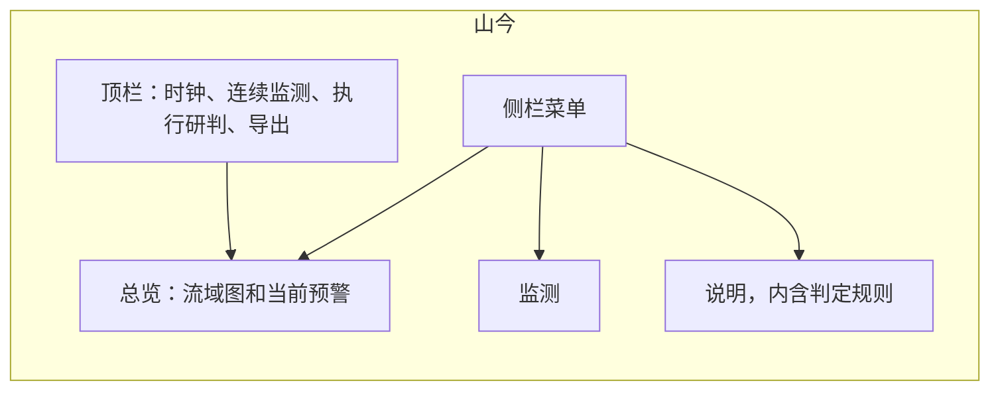
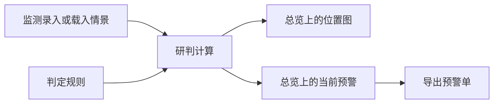

# 山今页面架构

单页值班后台，打开 `index.html` 即可使用。左侧是菜单，右侧是当前模块。监测值和判定规则仍在同一页里，切换菜单不会丢掉已填写的内容。

## 页面结构

| 区块 | 页面上看到什么 | 作用 |
| --- | --- | --- |
| 侧栏 | 山今、总览、监测、说明 | 在同一页里切换模块。判定规则在说明里 |
| 顶栏 | 当前模块名、预警条数、时钟、连续监测、执行研判、导出预警单 | 总控，每个模块都能用 |
| 总览 | 南湖示意图、等级颜色、当前预警 | 位置预警 |
| 监测 | 最左导航下的地点子栏，点开后右侧只显示该点 | 自定义数据 |
| 说明 | 使用说明，以及暴雨、大风、台风、内涝、地质、高温和汇流的判定规则 | 说明和阈值，分区样式与监测相同 |

## 闭环怎么走

连续监测打开时，改监测值或改阈值会立刻重算当前预警和地图。点「执行研判」会按当时结果生成预警单，导出使用的也是这一轮计算。

## 文件对应

| 文件 | 职责 |
| --- | --- |
| `index.html` | 后台骨架：侧栏、顶栏、总览、监测、说明 |
| `css/admin.css` | 后台外观 |
| `css/console.css` | 流域图、表格和录入区的功能样式 |
| `js/data.js` | 初始监测点、初始数值、初始阈值、演示情景 |
| `js/engine.js` | 阈值检查、产流汇流、台风衰减、地质风险分、预警条目 |
| `js/app.js` | 把录入、规则和计算结果画到页面上 |
